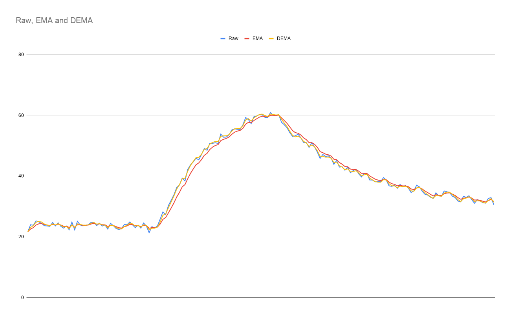

# Double Exponential Moving Average (DEMA) Filter Module

## Overview

The **Double Exponential Moving Average (DEMA)** filter is a high-performance digital signal processing module designed for low-latency smoothing of noisy discrete time-series data. Standard exponential moving averages (EMA) introduce dynamic lag when tracking fast transients; the DEMA algorithm overcomes this limitation by combining single and double exponential smoothing stages to compensate for Phase/Group Delay while retaining effective high-frequency noise suppression. Written in pure C with zero external runtime dependencies, it is fully optimized for real-time embedded systems, sensor conditioning pipelines, and fast control loops.

 

### Key Features

* **Zero-Lag Phase Tracking:** Employs a dual-stage cascading EMA structure ($2 \cdot \text{EMA}_1 - \text{EMA}_2$) that eliminates first-order phase delay and reduces step lag significantly compared to traditional moving average filters.
* **Warm-Up State Initialization:** Features a warm-up mechanism to prevent startup transients by pre-charging internal states ($\text{ema}_1$ and $\text{ema}_2$) upon processing the initial sample or calling reset functions.
* **Quality & Verification:** Verified using Ceedling/Unity complemented by Doxygen-compatible inline documentation.

---

## Controller Performance & Simulation

The following response graph demonstrates the dynamic filtering performance of the DEMA module against raw, noisy sensor data. It highlights rapid step-response tracking with minimal phase lag while effectively filtering out high-frequency measurement noise:

---

## Project Structure

```text
dema_filter/
├── docs/                   # Doxygen configuration
├── dema_filter.h           # Public API
├── dema_filter.c           # Filter algorithm implementation
├── test/                   # Unit testing environment
│   ├── support/            # Auxiliary headers and Ceedling mocks
│   ├── project.yml         # Ceedling project configuration
│   └── test_dema_filter.c  # Unit test suite for filter logic
└── README.md               # Main project documentation

```

---

## Integration and Getting Started

### Integration Scheme

Integration consists of instantiating the `dema_filter_t` context structure, initializing filter parameters via `dema_filter_init()`, and executing `dema_filter_update()` inside your sensor sampling loop.

---

### Integration Steps

1. Copy `dema_filter.h` and `dema_filter.c` into your project's source tree.
2. Include `"dema_filter.h"` in your sensor processing or application module.
3. Declare a `dema_filter_t` instance.
4. Call `dema_filter_init()` passing your context reference.
5. Periodically invoke `dema_filter_update(&filter, raw_sample)` whenever a new raw measurement is acquired from your sensor interface.

---

### Code Examples

#### Example Usage

The following example demonstrates how to initialize the DEMA filter and process noisy sample data in a real-time sampling loop.

```c
/**
 * @file main.c
 * @brief Minimal usage example for the DEMA filter module.
 * 
 * SPDX-License-Identifier: MIT
 */

#include <stdio.h>
#include <stdbool.h>
#include "dema_filter.h"

int main(void) {
    dema_filter_t filter;
    float sample_time_s = 0.01f;  // 10 ms sampling period (100 Hz)
    float cutoff_freq_hz = 5.0f;  // 5 Hz low-pass cutoff frequency

    // 1. Initialize the filter with the sampling period
    if (dema_filter_init(&filter, sample_time_s) != 0) {
        printf("Initialization failed!\n");
        return 1;
    }

    // 2. Set the desired cutoff frequency (calculates optimal alpha internally)
    if (dema_filter_set_cutoff(&filter, cutoff_freq_hz) != 0) {
        printf("Invalid cutoff frequency!\n");
        return 1;
    }

    // Dummy raw sensor samples representing a real-time stream
    float raw_samples[] = {10.2f, 15.5f, 14.1f, 12.8f, 13.0f, 50.0f, 52.1f, 49.8f};
    size_t num_samples = sizeof(raw_samples) / sizeof(raw_samples[0]);

    float filtered_sample = 0.0f;

    // 3. Real-time filtering loop
    for (size_t i = 0; i < num_samples; i++) {
        float raw = raw_samples[i];

        // Update filter with the new raw sample
        if (dema_filter_update(&filter, raw, &filtered_sample) == 0) {
            printf("Raw: %.2f --> Filtered: %.2f\n", raw, filtered_sample);
        }
    }

    return 0;
}

```

---

## Running Unit Tests

The development environment uses **Ceedling** (along with **Unity** and **CMock**) for hardware-decoupled unit testing.

### Prerequisites

* **Ruby** (for executing the Ceedling engine)
* **Ceedling** (unit testing framework for C)
* **gcovr** (optional, for coverage reporting)

### Execution Commands

1. Navigate to the test directory:

```bash
cd test

```

2. Run the full unit test suite:

```bash
ceedling test:all

```

3. Generate code coverage report:

```bash
ceedling gcov:all

```

The resulting HTML report will be available at:
`test/build/artifacts/gcov/gcovr/index.html`

---

## Generating Documentation

The public API is fully documented using **Doxygen**-compatible comment blocks.

### Option 1: Via Command Line

1. Navigate to the `docs/` directory:

```bash
cd docs

```

2. Build the documentation using the `doxyfile` configuration file:

```bash
doxygen doxyfile

```

3. Open the generated file in your web browser:

```bash
xdg-open html/index.html

```

### Option 2: Via Graphical User Interface

1. Launch Doxywizard from the terminal:

```bash
doxywizard

```

2. Select **File > Open** and open the `doxyfile` inside the `docs/` directory.
3. Select the **Run** tab -> Click **Run doxygen**.
4. Open `html/index.html` in your browser.

---

## License

This project is distributed under the **MIT** License.